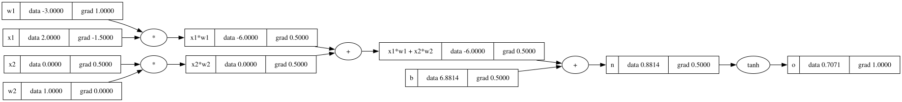
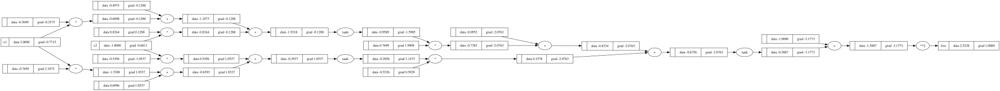
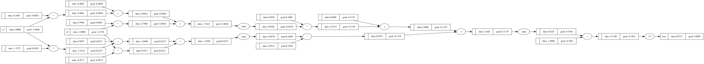

# Micrograd: Scalar-Valued Autograd Engine & Neural Network Library

A lightweight, purely educational autograd engine and neural network library implemented from scratch in Python. It implements reverse-mode automatic differentiation (backpropagation) over dynamically constructed Directed Acyclic Graphs (DAGs) of scalar values, paired with automated Graphviz graph visualization.

---

## Table of Contents
1. [Architectural Overview](#architectural-overview)
2. [Core Theoretical Concepts](#core-theoretical-concepts)
   - [Scalar Autograd & The `Value` Abstraction](#scalar-autograd--the-value-abstraction)
   - [The Chain Rule & Gradient Accumulation](#the-chain-rule--gradient-accumulation)
   - [Topological Sorting of the DAG](#topological-sorting-of-the-dag)
3. [Neural Network Hierarchy](#neural-network-hierarchy)
4. [Computational Graph Visualization](#computational-graph-visualization)
5. [Case Study 1: Single Neuron Computational Graph](#case-study-1-single-neuron-computational-graph)
   - [Mathematical Formulation](#mathematical-formulation)
   - [Manual vs Autograd Derivative Walkthrough](#manual-vs-autograd-derivative-walkthrough)
   - [Rendered Computation Graph (`neuron_graph.svg`)](#rendered-computation-graph-neuron_graphsvg)
6. [Case Study 2: MLP Training & Graph Evolution](#case-study-2-mlp-training--graph-evolution)
   - [Architecture & Loss Formulation](#architecture--loss-formulation)
   - [Visual Snapshot at Step 0 (`train_step_0.svg`)](#visual-snapshot-at-step-0-train_step_0svg)
   - [Visual Snapshot at Step 19 (`train_step_19.svg`)](#visual-snapshot-at-step-19-train_step_19svg)
   - [Comparative Analysis of Convergence](#comparative-analysis-of-convergence)
7. [Case Study 3: Full Multi-Sample Classification](#case-study-3-full-multi-sample-classification)
8. [Project Structure & Quickstart Guide](#project-structure--quickstart-guide)

---

## Architectural Overview

Deep learning frameworks like PyTorch and JAX operate on multi-dimensional tensors. **Micrograd** strips away the complexity of tensor batching, CUDA memory management, and strides, exposing the fundamental mechanics of:
1. **Dynamic computation graph construction** during the forward pass.
2. **Local derivative evaluation** via automatic differentiation primitives.
3. **Reverse-mode backpropagation** over topologically sorted nodes.
4. **Gradient descent optimization** directly updating learnable parameters.

```
       [Input Values: x, w, b]
                  │
                  ▼
         Forward Pass (DAG)
  (Tracks children & operators: +, *, tanh)
                  │
                  ▼
            Output / Loss
                  │
                  ▼
      Backward Pass (Reverse Topo)
     (Chain Rule Gradient Flow: dL/dv)
                  │
                  ▼
    Gradient Descent Parameter Update
           (p.data -= lr * p.grad)
```

---

## Core Theoretical Concepts

### Scalar Autograd & The `Value` Abstraction

At the heart of the engine is the [`Value`](file:///home/gpuserver1/projects/GPT/micrograd/engine.py#L3-L88) class defined in [`engine.py`](file:///home/gpuserver1/projects/GPT/micrograd/engine.py). Every scalar value carries:
- `data`: The raw floating-point scalar value evaluated in the forward pass.
- `grad`: The accumulated partial derivative of the scalar loss $L$ with respect to this value ($\frac{\partial L}{\partial v}$). Initialized to `0.0`.
- `_prev`: A set of parent `Value` objects that generated this node.
- `_op`: The operator string (`+`, `*`, `tanh`, `**`, etc.) for debugging and rendering.
- `_backward`: A closure that implements the local chain rule, propagating gradients from the output of the operation back to its inputs.

```python
class Value:
    def __init__(self, data, _children=(), _op='', label=''):
        self.data = data
        self.grad = 0.0
        self._backward = lambda: None
        self._prev = set(_children)
        self._op = _op
        self.label = label
```

### The Chain Rule & Gradient Accumulation

For any node $z = f(x, y)$, reverse-mode automatic differentiation computes:
$$\frac{\partial L}{\partial x} = \frac{\partial L}{\partial z} \cdot \frac{\partial z}{\partial x}$$

#### Primitive Operations & Local Gradients:
1. **Addition (`__add__`)**:
   $$z = x + y \implies \frac{\partial z}{\partial x} = 1.0, \quad \frac{\partial z}{\partial y} = 1.0$$
   $$\frac{\partial L}{\partial x} += 1.0 \cdot \frac{\partial L}{\partial z}, \quad \frac{\partial L}{\partial y} += 1.0 \cdot \frac{\partial L}{\partial z}$$

2. **Multiplication (`__mul__`)**:
   $$z = x \cdot y \implies \frac{\partial z}{\partial x} = y, \quad \frac{\partial z}{\partial y} = x$$
   $$\frac{\partial L}{\partial x} += y \cdot \frac{\partial L}{\partial z}, \quad \frac{\partial L}{\partial y} += x \cdot \frac{\partial L}{\partial z}$$

3. **Power (`__pow__`)**:
   $$z = x^c \implies \frac{\partial z}{\partial x} = c \cdot x^{c-1}$$
   $$\frac{\partial L}{\partial x} += \left(c \cdot x^{c-1}\right) \cdot \frac{\partial L}{\partial z}$$

4. **Hyperbolic Tangent (`tanh`)**:
   $$t = \tanh(x) = \frac{e^{2x} - 1}{e^{2x} + 1} \implies \frac{dt}{dx} = 1 - t^2$$
   $$\frac{\partial L}{\partial x} += (1 - t^2) \cdot \frac{\partial L}{\partial t}$$

> [!IMPORTANT]
> **Why `+=` instead of `=` for Gradients?**
> In a general computational graph, a single `Value` can be an input to multiple subsequent operations (the multivariate chain rule: $\frac{\partial L}{\partial x} = \sum_{i} \frac{\partial L}{\partial y_i} \frac{\partial y_i}{\partial x}$). Using `+=` allows gradients arriving from multiple forward paths to accumulate correctly.

### Topological Sorting of the DAG

Backpropagation requires all nodes that depend on a variable $v$ to calculate and send their gradients before $v$ calculates its own gradient.

In [`engine.py#L74-L88`](file:///home/gpuserver1/projects/GPT/micrograd/engine.py#L74-L88), topological ordering is computed dynamically using depth-first search (DFS):

```python
def backward(self):
    topo = []
    visited = set()

    def build_topo(v):
        if v not in visited:
            visited.add(v)
            for child in v._prev:
                build_topo(child)
            topo.append(v)
    build_topo(self)

    self.grad = 1.0  # Seed gradient dL/dL = 1.0
    for node in reversed(topo):
        node._backward()
```

---

## Neural Network Hierarchy

Implemented in [`nn.py`](file:///home/gpuserver1/projects/GPT/micrograd/nn.py), standard neural network building blocks are constructed as modular layers:

- **[`Module`](file:///home/gpuserver1/projects/GPT/micrograd/nn.py#L4-L10)**: Base class defining `zero_grad()` to reset all parameter gradients to `0.0` before each training iteration, and `parameters()` to expose learnable weights.
- **[`Neuron`](file:///home/gpuserver1/projects/GPT/micrograd/nn.py#L12-L23)**: Computes the affine linear projection followed by non-linear activation:
  $$\text{act} = \tanh\left(\sum_{i=1}^{n_{\text{in}}} w_i x_i + b\right)$$
- **[`Layer`](file:///home/gpuserver1/projects/GPT/micrograd/nn.py#L25-L34)**: A collection of independent `Neuron` instances operating in parallel over the same input vector.
- **[`MLP`](file:///home/gpuserver1/projects/GPT/micrograd/nn.py#L36-L47)**: A multi-layer perceptron stacking multiple `Layer` instances sequentially:
  $$x^{(l)} = \text{Layer}^{(l)}\left(x^{(l-1)}\right)$$

---

## Computational Graph Visualization

Visual diagnostics are handled by [`visualize.py`](file:///home/gpuserver1/projects/GPT/micrograd/visualize.py) using Graphviz:
- **Rectangular Record Nodes**: Represent each `Value` node, rendering its user label (if present), current numerical value `data`, and accumulated derivative `grad`.
- **Circular Operator Nodes**: Represent each intermediate arithmetic operator (`+`, `*`, `tanh`, `**2`).
- **Directed Edges**: Illustrate exact forward data dependencies from input values through operations to outputs.

```
┌─────────────────────────────────┐
│              label              │
├────────────────┬────────────────┤
│  data: 0.7071  │  grad: 1.0000  │
└────────────────┴────────────────┘
```

---

## Case Study 1: Single Neuron Computational Graph

The script [`demo_neuron.py`](file:///home/gpuserver1/projects/GPT/micrograd/demo_neuron.py) defines a single 2-input artificial neuron with explicit weights and bias:

```python
x1 = Value(2.0, label='x1')
x2 = Value(0.0, label='x2')
w1 = Value(-3.0, label='w1')
w2 = Value(1.0, label='w2')
b = Value(6.8813735870195432, label='b')

x1w1 = x1 * w1;            x1w1.label = 'x1*w1'
x2w2 = x2 * w2;            x2w2.label = 'x2*w2'
x1w1x2w2 = x1w1 + x2w2;    x1w1x2w2.label = 'x1*w1 + x2*w2'
n = x1w1x2w2 + b;          n.label = 'n'
o = n.tanh();              o.label = 'o'
o.backward()
```

### Mathematical Formulation

1. **Linear Combinations**:
   $$x_1 w_1 = (2.0) \cdot (-3.0) = -6.0$$
   $$x_2 w_2 = (0.0) \cdot (1.0) = 0.0$$
   $$x_1 w_1 + x_2 w_2 = -6.0 + 0.0 = -6.0$$
   $$n = (x_1 w_1 + x_2 w_2) + b = -6.0 + 6.881373587 = 0.881373587$$

2. **Activation Output**:
   $$o = \tanh(n) = \tanh(0.881373587) \approx 0.70710678 \quad \left(\approx \frac{1}{\sqrt{2}}\right)$$

### Manual vs Autograd Derivative Walkthrough

| Variable | Forward Value (`data`) | Analytic Derivative $\frac{\partial o}{\partial v}$ | Micrograd Output (`grad`) |
| :--- | :--- | :--- | :--- |
| **$o$** | `0.7071` | $\frac{\partial o}{\partial o} = 1.0$ | **`1.0000`** |
| **$n$** | `0.8814` | $\frac{\partial o}{\partial n} = 1 - o^2 = 1 - (0.70710678)^2 = 0.5$ | **`0.5000`** |
| **$b$** | `6.8814` | $\frac{\partial o}{\partial b} = \frac{\partial o}{\partial n} \cdot \frac{\partial n}{\partial b} = 0.5 \cdot 1.0 = 0.5$ | **`0.5000`** |
| **$x_1 w_1 + x_2 w_2$** | `-6.0000` | $\frac{\partial o}{\partial (x_1 w_1 + x_2 w_2)} = 0.5 \cdot 1.0 = 0.5$ | **`0.5000`** |
| **$x_1 w_1$** | `-6.0000` | $0.5 \cdot 1.0 = 0.5$ | **`0.5000`** |
| **$x_2 w_2$** | `0.0000` | $0.5 \cdot 1.0 = 0.5$ | **`0.5000`** |
| **$w_1$** | `-3.0000` | $\frac{\partial o}{\partial (x_1 w_1)} \cdot x_1 = 0.5 \cdot 2.0 = 1.0$ | **`1.0000`** |
| **$x_1$** | `2.0000` | $\frac{\partial o}{\partial (x_1 w_1)} \cdot w_1 = 0.5 \cdot (-3.0) = -1.5$ | **`-1.5000`** |
| **$w_2$** | `1.0000` | $\frac{\partial o}{\partial (x_2 w_2)} \cdot x_2 = 0.5 \cdot 0.0 = 0.0$ | **`0.0000`** |
| **$x_2$** | `0.0000` | $\frac{\partial o}{\partial (x_2 w_2)} \cdot w_2 = 0.5 \cdot 1.0 = 0.5$ | **`0.5000`** |

### Rendered Computation Graph (`neuron_graph.svg`)

The full computational graph generated by [`demo_neuron.py`](file:///home/gpuserver1/projects/GPT/micrograd/demo_neuron.py) is rendered below:



> **Inspecting the Graph**:
> Notice how the seed gradient `grad 1.0000` at node `o` flows leftwards through the `tanh` operator (becoming `0.5000` at node `n`), distributes evenly across the addition nodes, and finally scales by the respective cross-values at the multiplication operators.

---

## Case Study 2: MLP Training & Graph Evolution

[`demo_mlp.py`](file:///home/gpuserver1/projects/GPT/micrograd/demo_mlp.py) demonstrates iterative training of a 2-layer neural network on a single training point:
- **Input**: $x = [2.0, -1.0]$
- **Target**: $y = 1.0$
- **Model**: `MLP(2, [2, 1])`
  - Layer 1: 2 inputs $\to$ 2 hidden neurons ($2 \times 2$ weights $+ 2$ biases = 6 parameters)
  - Layer 2: 2 hidden inputs $\to$ 1 output neuron ($2 \times 1$ weights $+ 1$ bias = 3 parameters)
  - **Total Parameters**: 9 learnable scalar values

### Architecture & Loss Formulation

For each training step:
1. **Forward Pass**: $\hat{y} = \text{model}(x)$
2. **Mean Squared Error Loss**: $L = (\hat{y} - y_{\text{target}})^2$
3. **Zero Gradients**: $\text{model.zero\_grad()}$
4. **Backward Pass**: $L.\text{backward}() \implies \frac{\partial L}{\partial p_i}$ for each parameter $p_i$
5. **SGD Update**: $p_i \leftarrow p_i - \eta \cdot \frac{\partial L}{\partial p_i}$ with learning rate $\eta = 0.05$

Visual snapshots were saved before updating weights at **Step 0** and **Step 19**.

---

### Visual Snapshot at Step 0 (`train_step_0.svg`)

At Step 0, parameters are randomly initialized. The initial model prediction is $\hat{y} \approx -0.5887$, resulting in a large error:
$$L = (-0.5887 - 1.0)^2 = (-1.5887)^2 \approx 2.5238$$

Local derivative of loss with respect to prediction:
$$\frac{\partial L}{\partial \hat{y}} = 2 \cdot (\hat{y} - 1.0) = 2 \cdot (-1.5887) \approx -3.1774$$



*In this initial state, gradients throughout the network are strong (indicated by `grad` values up to $\pm 3.1774$), pushing the weights vigorously in the direction that minimizes loss.*

---

### Visual Snapshot at Step 19 (`train_step_19.svg`)

By Step 19, after 20 gradient update steps, the weights have adapted:
- Prediction has moved from $-0.5887 \to \mathbf{+0.8220}$ (approaching the target $1.0$).
- Loss has decreased from $2.5238 \to \mathbf{0.0317}$ (a **98.7% reduction**).
- The gradient on the prediction has attenuated from $-3.1774 \to \mathbf{-0.3560}$.



*In this converged state, node `data` values are aligned to the target and `grad` values throughout all 9 parameters have diminished toward zero as the network nears the local minimum.*

---

### Comparative Analysis of Convergence

| Training Step | Model Prediction $\hat{y}$ | Target $y$ | Loss $L$ | Output Gradient $\frac{\partial L}{\partial \hat{y}}$ | Snapshot Saved |
| :---: | :---: | :---: | :---: | :---: | :---: |
| **0** | **`-0.5887`** | `+1.0` | **`2.523814`** | `-3.1774` | [train_step_0.svg](file:///home/gpuserver1/projects/GPT/micrograd/train_step_0.svg) |
| 1 | `-0.3052` | `+1.0` | `1.703503` | `-2.6104` | - |
| 2 | `+0.0600` | `+1.0` | `0.883680` | `-1.8800` | - |
| 4 | `+0.4769` | `+1.0` | `0.273676` | `-1.0462` | - |
| 8 | `+0.6908` | `+1.0` | `0.095629` | `-0.6184` | - |
| 12 | `+0.7636` | `+1.0` | `0.055874` | `-0.4728` | - |
| 16 | `+0.8025` | `+1.0` | `0.039021` | `-0.3950` | - |
| **19** | **`+0.8220`** | `+1.0` | **`0.031700`** | **`-0.3560`** | [train_step_19.svg](file:///home/gpuserver1/projects/GPT/micrograd/train_step_19.svg) |

---

## Case Study 3: Full Multi-Sample Classification

In [`train.py`](file:///home/gpuserver1/projects/GPT/micrograd/train.py), a larger 3-layer architecture (`MLP(3, [4, 4, 1])`, 41 parameters) is trained on a binary classification dataset with 4 multi-dimensional samples:

```python
xs = [
    [2.0, 3.0, -1.0],
    [3.0, -1.0, 0.5],
    [0.5, 1.0, 1.0],
    [1.0, 1.0, -1.0],
]
ys = [1.0, -1.0, -1.0, 1.0]

model = MLP(3, [4, 4, 1])  # 41 parameters
```

### 50-Epoch Training Curve

```
Step  0 | Loss: 1.647077
Step  5 | Loss: 0.129267
Step 10 | Loss: 0.069726
Step 20 | Loss: 0.035570
Step 30 | Loss: 0.023603
Step 40 | Loss: 0.017562
Step 49 | Loss: 0.014233
```

**Final Predictions vs Targets**:
- Sample 1: `Pred: +0.9501` | Target: `+1.0`
- Sample 2: `Pred: -0.9376` | Target: `-1.0`
- Sample 3: `Pred: -0.9389` | Target: `-1.0`
- Sample 4: `Pred: +0.9358` | Target: `+1.0`

The network accurately fits the non-linear decision boundary across all 4 samples with an average error $< 0.07$.

---

## Project Structure & Quickstart Guide

### Directory Layout

```
GPT/
├── micrograd/
│   ├── __init__.py         # Package exports (Value, Module, Neuron, Layer, MLP, draw_dot)
│   ├── engine.py           # Core scalar autograd engine
│   ├── nn.py               # Neural network layers (Module, Neuron, Layer, MLP)
│   ├── visualize.py        # Graphviz computational graph visualization
│   ├── demo_neuron.py      # Demo 1: Single neuron computation graph
│   ├── demo_mlp.py         # Demo 2: 2-layer MLP training with SVG snapshots
│   ├── train.py            # Demo 3: Multi-sample toy classification
│   ├── notes.txt           # Implementation notes & scratchpad
│   ├── README.md           # This comprehensive guide
│   ├── neuron_graph.svg    # Visual output of demo_neuron
│   ├── train_step_0.svg    # Visual output of demo_mlp at step 0
│   └── train_step_19.svg   # Visual output of demo_mlp at step 19
├── requirements.txt
└── README.md
```

### Running the Scripts

Activate your virtual environment and execute any of the following:

```bash
# Activate virtual environment
source .venv/bin/activate

# 1. Single neuron forward & backward pass + graph export:
python micrograd/demo_neuron.py

# 2. MLP training with step 0 & step 19 visual snapshot generation:
python micrograd/demo_mlp.py

# 3. Multi-sample toy dataset training:
python micrograd/train.py
```

### Importing into External Code

```python
from micrograd import Value, MLP, draw_dot

# Build custom expressions
a = Value(-4.0)
b = Value(2.0)
c = a + b
d = a * b + b**3
c += c + 1
c += 1 + c + (-a)
d += d * 2 + (b + a).tanh()
d += 3 * d + (b - a).tanh()
e = c - d
f = e**2
g = f / 2.0
g += 10.0 / f

# Backpropagate
g.backward()

# Render computation graph
dot = draw_dot(g)
dot.render('custom_graph', format='svg', cleanup=True)
```
